# Project Screenshots

This gallery provides visual evidence of the functionality, enhancements, testing, and validation documented throughout the CS 499 ePortfolio.

---

## Software Engineering & Design

### Refactored Grazioso Salvare Dashboard

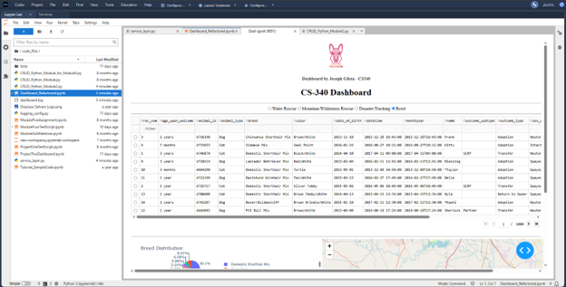

*The enhanced Grazioso Salvare dashboard running in JupyterLab after the software-engineering refactor.*

### Input Validation

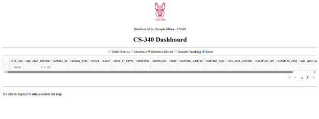

*Invalid DataTable filter input (`1 = 1`) is handled without crashing the application. The dashboard returns no matching data rather than attempting to process the invalid filter.*

### Structured Logging

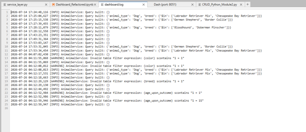

*Structured application logs include timestamps, log levels, service-layer messages, and information about application activity.*

### Service Layer & Dependency Injection

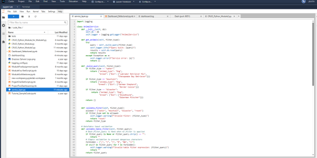

*The `AnimalService` implementation demonstrates the dedicated service layer, validation logic, and injected database dependency introduced during the enhancement.*

### Service-Layer Tests

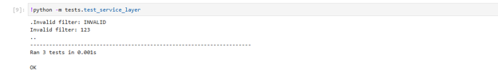

*Automated service-layer test output verifies expected behavior for valid and invalid inputs.*

### Functional Validation After Refactoring

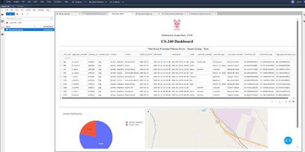

*The enhanced dashboard continues to update the DataTable, visualization, and map when the Mountain/Wilderness Rescue filter is selected, verifying that functionality was preserved after the architectural refactor.*

---

## Algorithms & Data Structures

### AVL Application Functionality

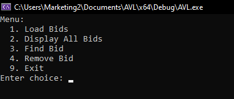

*The enhanced AVL-tree implementation preserves the application's original menu-driven operations after replacing the unbalanced binary search tree.*

### AVL Search

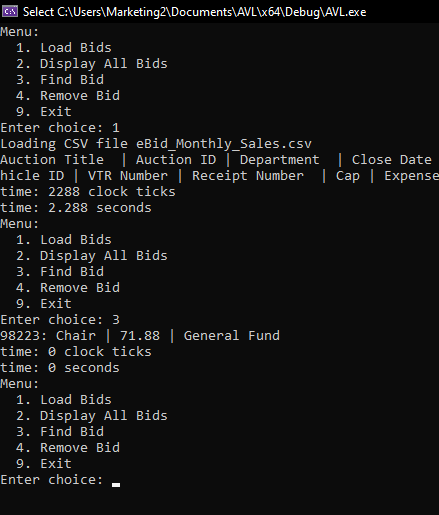

*The enhanced tree successfully locates the requested bid record using the AVL-based implementation.*

---

## Databases & Secure Data Handling

### Logging Configuration

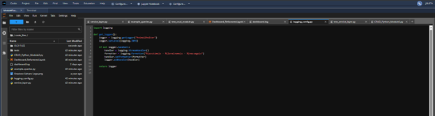

*The enhanced project structure and `logging_config.py` demonstrate the logging configuration introduced for database and service-layer operations.*

### Advanced Query Examples

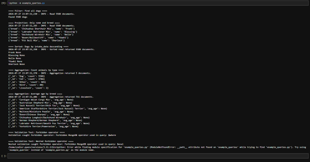

*Console output from `example_queries.py` demonstrates the enhanced module's filtering, projection, sorting, aggregation, and query functionality.*

### Automated CRUD & Validation Tests

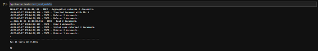

*Automated test output from `test_crud_module.py` verifies CRUD behavior, filtering, projection, aggregation, and validation in the enhanced data-access layer.*

---

## Continue Exploring

- [Home](index.md)
- [Software Engineering & Design](artifacts/software-engineering.md)
- [Algorithms & Data Structures](artifacts/algorithms.md)
- [Databases & Secure Data Handling](artifacts/databases.md)
- [Code Review](code-review.md)
- [Repository Overview](README.md)
